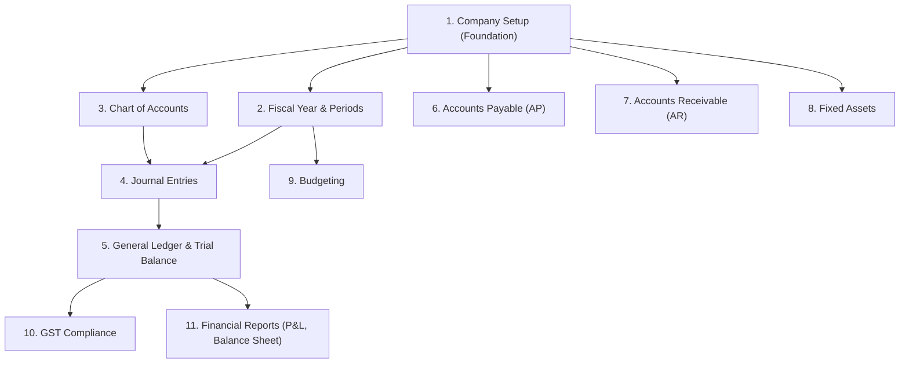

# SAP OneERP — FICO Module Preparation Guide & Implementation

Complete end-to-end guide covering **Business Understanding**, **Backend Fundamentals**, **Company Setup Practical Exercise**, and **Meeting Preparation**.

---

## 1. System Overview & Running Services

| Component | URL | Port / Protocol | Details |
| :--- | :--- | :--- | :--- |
| **Frontend UI (React + Tailwind)** | [http://localhost:5173/](http://localhost:5173/) | 5173 (Vite HMR) | STACKLY OneERP FICO Dashboard |
| **Backend REST API (FastAPI)** | [http://localhost:8000/](http://localhost:8000/) | 8000 (Uvicorn ASGI) | Python 3.14 + FastAPI + SQLAlchemy |
| **Interactive API Documentation** | [http://localhost:8000/docs](http://localhost:8000/docs) | 8000 (Swagger UI) | Interactive API playground & schemas |
| **ReDoc API Documentation** | [http://localhost:8000/redoc](http://localhost:8000/redoc) | 8000 (ReDoc) | Clean API reference specification |

---

## 2. Step 1: What We Are Building

### 1.1 What is an ERP system?
An **ERP (Enterprise Resource Planning)** system integrates core business functions into a single unified platform. When a company purchases machinery, procurement generates the purchase order, inventory capitalizes the asset, finance records the liability and payment, and financial statements reflect the depreciation and balance sheet impact.

### 1.2 What is SAP FICO?
FICO stands for **Financial Accounting (FI)** and **Controlling (CO)**:
- **FI (Financial Accounting)**: External reporting for statutory compliance, tax authorities, banks, and auditors (General Ledger, AP, AR, Asset Accounting, Financial Statements).
- **CO (Controlling)**: Internal management reporting (Cost Centers, Profit Centers, Internal Orders, Budgeting).

### 1.3 What is a Chart of Accounts (CoA)?
The master list of financial accounts categorized into:
1. **Assets** (e.g. 100000 Cash, 110000 Receivables, 150000 Machinery)
2. **Liabilities** (e.g. 200000 Trade Payables)
3. **Equity** (e.g. 300000 Share Capital)
4. **Revenue** (e.g. 400000 Services Revenue)
5. **Expenses** (e.g. 500000 Rent & Office Expenses)

### 1.4 Double-Entry Accounting Principle
Every financial transaction consists of balanced **Debits (Dr)** and **Credits (Cr)**:
$$\sum \text{Debit} = \sum \text{Credit}$$

---

## 3. Step 2: FICO Dashboard Architecture & Dependencies



### Why Company Setup Comes First
In SAP/FICO, the **Company Code** is the smallest organizational accounting unit for which a complete, self-contained set of accounts can be produced. You cannot define fiscal periods, currency exchange, chart of accounts assignments, or post vouchers without first defining the legal company entity.

---

## 4. Step 3 & 4: Backend Technologies & Database Schema

### Technologies
- **Python**: 3.14
- **FastAPI**: 0.143+ (Modern async ASGI framework with Pydantic v2 validation)
- **SQLAlchemy**: 2.1+ ORM (Object Relational Mapping)
- **Database**: SQLite (`saperp.db`) / MySQL (`saperp` database)
- **Uvicorn**: High-performance ASGI server

### Database Schema (`companies` table)
```sql
CREATE TABLE companies (
    id INTEGER PRIMARY KEY AUTOINCREMENT,
    company_name VARCHAR(100) NOT NULL,
    company_code VARCHAR(20) UNIQUE NOT NULL,
    country VARCHAR(50) DEFAULT 'India',
    currency VARCHAR(10) DEFAULT 'INR',
    financial_year_start VARCHAR(50) DEFAULT '01-April',
    address VARCHAR(255),
    status VARCHAR(20) DEFAULT 'Active',
    created_at DATETIME DEFAULT CURRENT_TIMESTAMP
);
```

---

## 5. Step 5 & 6: Company Setup API Endpoints

| HTTP Method | Route | Description | Status Code | Error Cases |
| :--- | :--- | :--- | :--- | :--- |
| `POST` | `/companies/` | Create a new company record | `201 Created` | `400 Bad Request` if duplicate company code |
| `GET` | `/companies/` | List all companies | `200 OK` | `500` on database failure |
| `GET` | `/companies/{id}` | Get single company by ID | `200 OK` | `404 Not Found` if ID does not exist |
| `PUT` | `/companies/{id}` | Update company details | `200 OK` | `404 Not Found` if ID does not exist |
| `DELETE` | `/companies/{id}` | Delete company | `200 OK` | `404 Not Found` or `400` if rules forbid |

---

## 6. How to Run & Test

### Run Backend
```powershell
python -m uvicorn backend.main:app --host 0.0.0.0 --port 8000 --reload
```

### Run Frontend
```powershell
npm run dev -- --host
```

### Run Automated Pytest Suite
```powershell
python -m pytest backend/test_api.py -v
```

---

## 7. Step 7: Meeting Preparation & Q&A

### Q1: "Why did you choose FastAPI for the FICO backend?"
> *"FastAPI offers automatic validation using Pydantic, high async performance, clean dependency injection (`Depends(get_db)` for database session lifecycle), and generates interactive OpenAPI/Swagger documentation (`/docs`) out of the box."*

### Q2: "How do you handle duplicate Company Codes?"
> *"We enforce a unique constraint both at the database level (`unique=True` on `company_code`) and at the API level by querying for existing codes prior to insertion. If a duplicate is submitted, the API returns HTTP 400 Bad Request with a clear message: `'Company code already exists'`."*

### Q3: "How does the double-entry rule get validated in Journal Entries?"
> *"In `POST /api/journal-entries/`, we calculate `sum(item.debit)` and `sum(item.credit)`. If they do not match exactly, the transaction is rejected with HTTP 400 and a 'Double-entry violation' error, preventing unbalanced ledger postings."*

